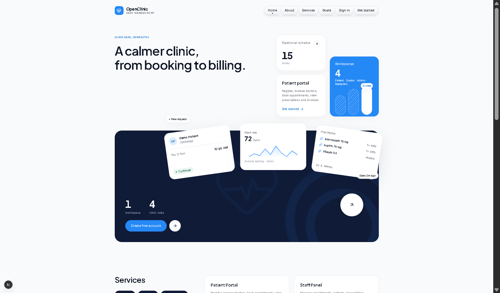
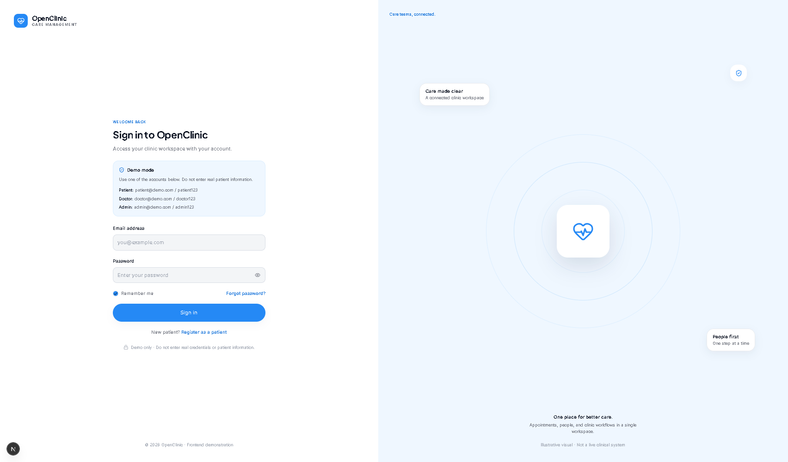
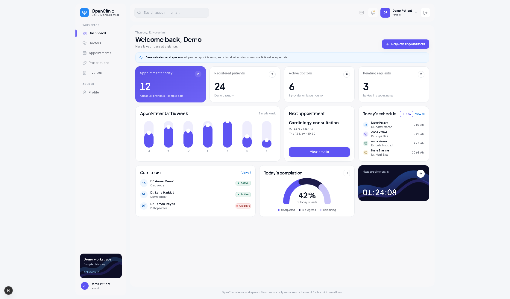
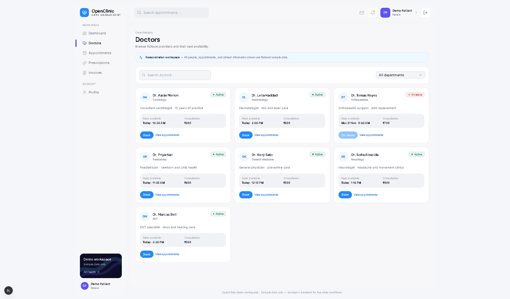
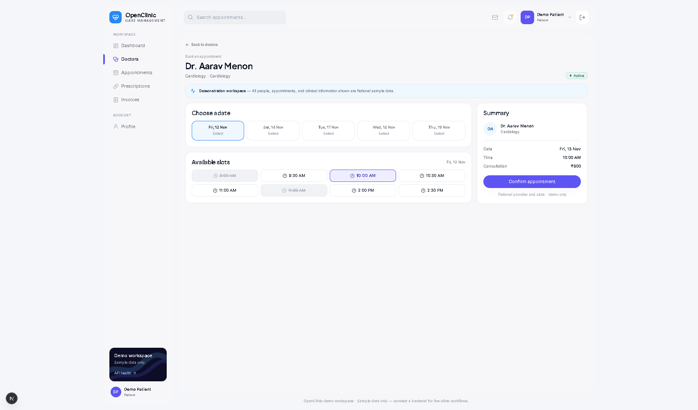
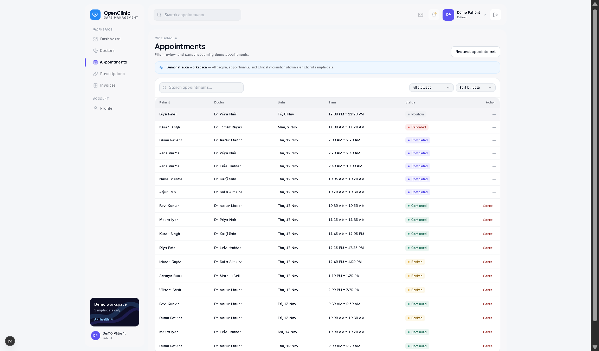
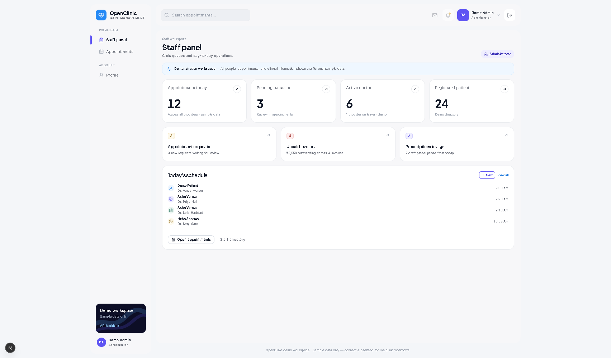
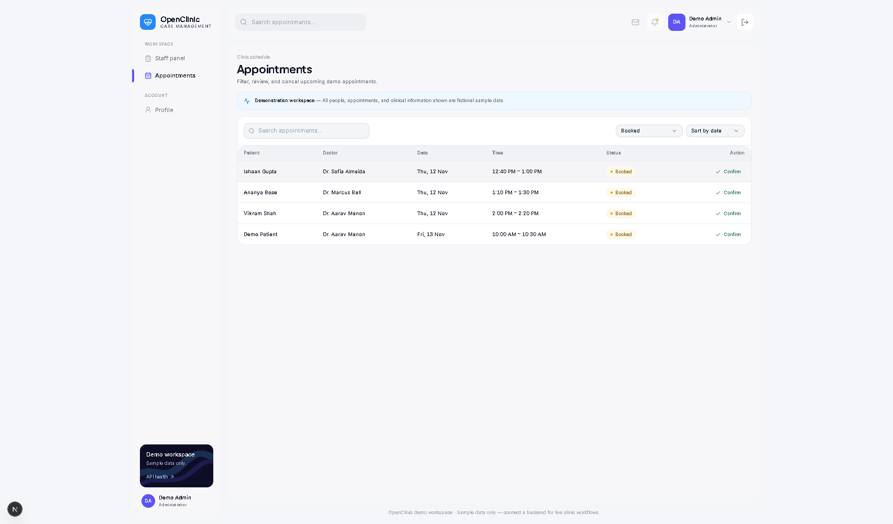
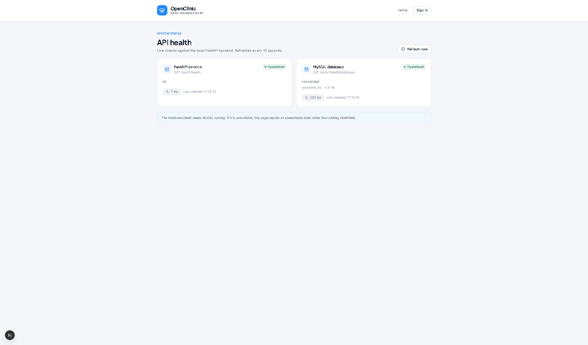

# OpenClinic — Project Report

**Project:** OpenClinic — a clinic management & patient appointment system (educational DBMS project)
**Repository:** https://github.com/ashokknayak1234/clinic-manager
**Frontend branch:** `feat/nextjs-frontend` (kept in sync with `main`)
**Latest commit:** `b20f29d` (2026-11-15)

---

## 1. What it is

OpenClinic is a full-stack clinic management web application that models a real
clinic's day-to-day work: patients register and request appointments, staff
(doctor / admin / receptionist) review and confirm them, and the system tracks
prescriptions, invoices and clinic health. It is built as an educational
DBMS (database management systems) project, so it deliberately demonstrates
relational database concepts — foreign keys, check constraints, views, stored
procedures and audit triggers — through realistic clinic workflows.

The system has three cooperating parts:

| Part | Technology | Role |
| --- | --- | --- |
| **Backend API** | Python + FastAPI (REST, JWT auth) | Authentication, database access, health checks |
| **Database** | MySQL 8 (`openclinic_db`, 15 tables, 2 views, triggers, procedures) | Persistent clinic data |
| **Frontend** | React 19 + Next.js 16 (TypeScript, Tailwind CSS 4, shadcn/ui) | All user-facing screens |

---

## 2. Why it was needed

1. **A real workflow to model.** Appointment booking/confirmation, prescriptions
   and billing give the database genuine relational meaning — every appointment
   links a patient, doctor, department and time slot.
2. **Demonstrate integrity rules that matter.** The schema prevents
   double-booking a slot (unique constraint), keeps invoice balances consistent
   (views + triggers), and audits every appointment change.
3. **Show role-based access control.** Different roles (PATIENT, DOCTOR, ADMIN,
   RECEPTIONIST) see different navigation and actions — a core real-world
   requirement for clinic software.
4. **A modern, responsive user experience.** The new frontend (this report's
   focus) rebuilds the older React-Vite prototype as a production-grade
   Next.js 16 application.

---

## 3. How the frontend works

### 3.1 Architecture

```
frontend/
├── app/                      # Next.js App Router — 14 routes in 3 groups
│   ├── (marketing)/          # /  (landing page with PillNav header + footer)
│   ├── (auth)/               # /login  /register
│   ├── (portal)/             # /dashboard /doctors /appointments /prescriptions
│   │                         # /invoices /staff /profile  (+ booking sub-route)
│   └── health/               # live API + database status page
├── components/
│   ├── brand/                # OpenClinic logo block
│   ├── marketing/            # pill-nav.tsx (+ .css), footer, hero media
│   ├── portal/               # table views, dialogs, status badges, role gate
│   ├── auth/                 # role-gate, demo banner
│   └── ui/                   # shadcn/ui primitives (button, input, dialog…)
├── features/api/
│   └── mock.ts               # typed demo data adapter (TODO(api) markers)
├── providers/                # auth-provider (JWT session), app providers
├── lib/                      # formatting, demo clock, utilities
└── shared/apiTypes.ts        # TypeScript contracts shared with the backend
```

- **Routing:** the App Router with *route groups* separates public marketing
  pages, authentication pages and the signed-in portal. Each portal page is
  wrapped by a layout that renders the sidebar and topbar.
- **Auth:** `POST /api/v1/auth/login` (real FastAPI call) returns a JWT; the
  auth provider stores it (with an optional "remember me" persistent session),
  attaches it as a bearer token, and clears the session on a 401.
- **Data:** clinical screens currently read from a typed in-memory demo adapter
  (`features/api/mock.ts`). Every function carries a `TODO(api)` marker naming
  the future backend endpoint, so swapping mock → real API is a mechanical
  change of the adapter only.
- **API proxy:** Next.js rewrites `/api/*` to the backend (`http://127.0.0.1:8000`),
  so the browser never talks to the backend directly and no CORS setup is needed.
- **Role gating:** `RoleGate` components restrict routes/actions by role.
  A "demo clock" freezes "today" at a fixed timestamp so the demo data and the
  UI always agree and screenshots reproduce.

### 3.2 The appointment workflow (owner-directed rules, Nov 2026)

1. **Only a PATIENT can request an appointment.** The booking route
   (`/doctors/:id/book`) is wrapped in a role gate ("Patients only"); staff do
   not see any Book buttons on the doctors list.
2. The patient picks a date and an available time slot and confirms. The
   request is recorded with status **BOOKED** (pending) and a banner explains
   it stays *Booked until clinic staff confirm it*.
3. **Staff (DOCTOR/ADMIN/RECEPTIONIST) confirm requests.** The staff panel's
   "Appointment requests" card deep-links to `/appointments?status=BOOKED`
   (the filter re-syncs with the URL). Each pending row shows a **Confirm**
   button; confirming flips the row to **CONFIRMED** with a toast
   "Appointment confirmed for … (demo table)."
4. Requests appear in the patient's appointments table immediately; both sides
   read the same demo store during a browser session (rows reset on a full
   page reload — documented demo behaviour).

### 3.3 The PillNav header (React Bits integration)

The marketing header navigation is the open-source **React Bits `<PillNav />`**
component:

- Converted from JavaScript to TypeScript, re-styled entirely through the
  project's CSS variables (`--color-primary-500`, `--color-accent-500`, …) —
  no raw colours outside `app/globals.css`.
- Renders the spec's navigation items verbatim: Home · About · Services ·
  Goals · Sign in · Get started.
- Behaviours: animated "fill" hover, sliding active-page dot, glass surface,
  and automatic collapse into a burger menu on narrow screens (verified at
  ~550 px). The OpenClinic wordmark stays on the left of the pill bar.

---

## 4. Build components & tooling

| Component | Version / choice | Why |
| --- | --- | --- |
| Next.js | 16.4.6 (App Router, Turbopack) | Server routing, API rewrite proxy, fast dev builds |
| React | 19.3.1 | Current stable runtime |
| TypeScript | strict mode | Type-safe contracts shared with backend types |
| Tailwind CSS | 4 | Utility styling from a single token file (`globals.css`) |
| shadcn/ui (radix-nova) | 4.23 | Accessible primitives (dialog, select, dropdown, toast) |
| lucide-react | icons | Consistent icon set |
| motion / Lenis | 14.x / 1.3.x | Entrance animations / smooth scroll (reduced-motion aware) |
| ESLint | next + react-hooks v6 | Code-quality gates — all clean |
| FastAPI + uvicorn | backend | REST API, JWT auth, bcrypt password hashing |
| MySQL 8 | database | Relational store with views/procedures/triggers |

**Quality gates (all passing at commit `b20f29d`):**
`npx tsc --noEmit` clean · `npm run lint` clean · `npm run build` clean (14
routes, static prerendered) · Lighthouse `/` desktop: Accessibility 95,
Best Practices 100, SEO 100, Performance 100.

---

## 5. Verification performed (browser, 2026-11-15)

- PillNav renders with all six items; items navigate; collapse → burger menu
  → panel → navigation verified at narrow width; console clean on every route.
- Doctor login → no Book buttons anywhere; visiting the booking URL shows the
  "Patients only" gate.
- Patient login → booked a slot → new **Booked** row appeared in the
  appointments table; success banner says the request awaits staff confirmation.
- Admin login → queue card opened the Booked-filtered queue (3 canonical
  pending rows); Confirm on a pending row flipped it to **Confirmed** with the
  toast, and it left the pending filter.
- Bugs found and fixed during this sweep: mock slot end-times (`09:30–09:00` →
  `09:30–10:00`) and the status filter not re-syncing when leaving the
  deep-linked queue (both logged in `frontend/DEVIATIONS.md` entries 16–17).

---

## 6. Known limitations (documented, by design)

1. Clinical data is a **demo adapter** — booking/confirming only mutates the
   in-memory demo table until the backend appointment endpoints are wired
   (`TODO(api)` markers name each one). Rows added in a session reset on a
   full page reload.
2. Static KPI cards ("appointments today", "pending requests") are computed at
   import time and don't live-update after a confirm; the appointments table is
   the live source of truth.
3. Backend register bug: new accounts become RECEPTIONIST (`role_id = 4`
   hardcoded in `backend/app/repositories/users.py`) — documented, not fixed
   (backend frozen for this phase).
4. Demo KPI copies some binding palette values sit below WCAG AA on certain
   surfaces; kept verbatim by owner decision (see `frontend/DEVIATIONS.md` 6).

Every divergence from the design spec is logged append-only in
`frontend/DEVIATIONS.md`; every owner permission (database restore, branch
pushes) in `docs/PERMISSIONS_LOG.md`.

---

## 7. How to run it

```bash
# 1. Database (MySQL 8 running locally; scripts in database/)
mysql -u root -p < database/schema.sql      # then seed.sql, views.sql,
                                            # procedures.sql, triggers.sql

# 2. Backend  (http://127.0.0.1:8000)
cd backend && uvicorn app.main:app --host 127.0.0.1 --port 8000

# 3. Frontend (http://localhost:3000 — use localhost, not 127.0.0.1)
cd frontend && npm install && npm run dev

# Demo logins: patient@demo.com/patient123 · doctor@demo.com/doctor123
#              admin@demo.com/admin123
```

Production build: `cd frontend && npm run build && npm start`.

---

## 8. Screenshots (desktop, 1440×900 viewport)

### Marketing landing page — React Bits PillNav header



### Sign-in page (demo credentials shown, real JWT backend)



### Patient dashboard ("Welcome back, Demo")



### Doctors list (patient view — Book buttons visible)



### Booking page — date + slot selected, live summary



### Patient's appointments — new request sits as "Booked" (pending)



### Staff panel — queue cards (appointment requests deep-link to the Booked filter)



### Staff queue — Booked filter with per-row Confirm action



### API health — live FastAPI + MySQL checks


